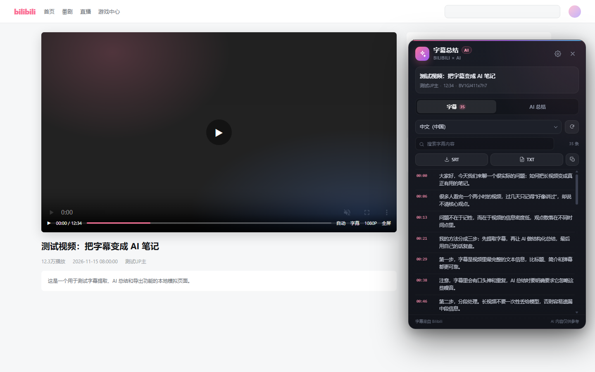
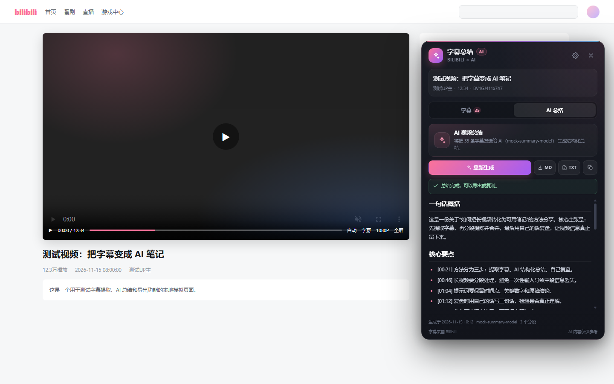
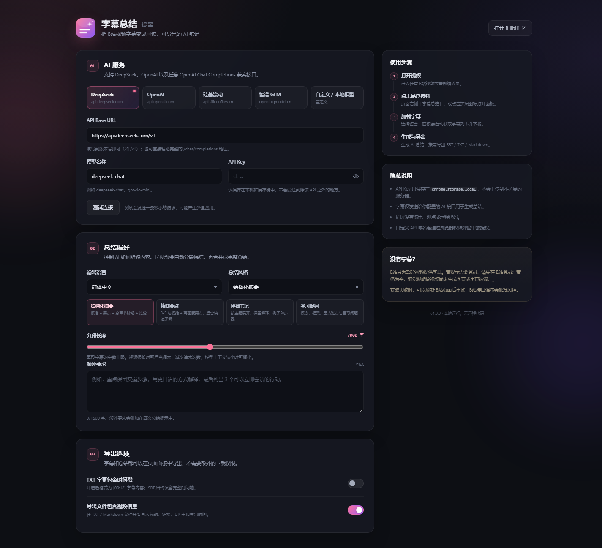
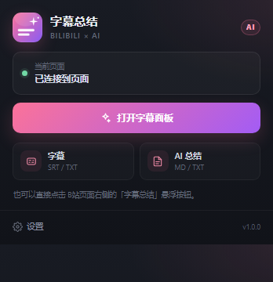

# B站字幕 AI 总结

[](https://github.com/MasterOwen/bilibili-subtitle-ai/actions/workflows/ci.yml)
[](https://github.com/MasterOwen/bilibili-subtitle-ai/releases/latest)
[](LICENSE)
[](#安装)

一个 Chrome / Edge 浏览器扩展（Manifest V3）：在 Bilibili 视频播放页获取当前视频字幕，交给 AI 生成结构化总结，并支持导出字幕与总结文件。

字幕可以直接导出为 **SRT**、**TXT**；AI 总结可以导出为 **Markdown**、**TXT**。所有数据只在本机处理，不经过本扩展的服务器。

## 功能

- **自动识别视频**：支持普通视频、多 P 视频、稍后再看/收藏夹/合集列表播放页和番剧播放页，SPA 切换视频后自动刷新。
- **读取当前字幕**：从 Bilibili 播放器接口读取字幕轨，自动选择当前浏览器语言对应的字幕。
- **字幕搜索与跳转**：按关键词筛选字幕；点击时间点跳转到视频对应位置。
- **AI 视频总结**：支持 DeepSeek、OpenCode Go、OpenAI、硅基流动、智谱 GLM，以及任意 OpenAI Chat Completions 兼容接口。
- **复制提示词**：无论是否配置 API Key，都可以把完整提示词复制到剪贴板，粘贴到 ChatGPT、Claude、DeepSeek 等网页 AI 中生成总结。
- **长视频分段总结**：字幕按字数分段提炼，再合并为全局总结，避免一次性输入导致中段信息丢失。
- **深度思考实时显示**：推理模型返回的思考过程（`reasoning_content`、`reasoning`、`reasoning_details` 等字段）会实时流式显示在「深度思考」区域，可随时展开或折叠。
- **五种输出风格**：结构化摘要、精简要点、详细笔记、学习提纲、逐字稿，设置页和 AI 面板均可切换。逐字稿保留原话内容与时间点，只做去语气词、补标点、分段，不做概括。
- **总结历史**：每次生成的总结会和字幕快照、模型、风格、生成时间一起保存在本机（按 bvid 归档，多 P 按时段区分）。刷新页面或关闭标签页后自动恢复，也能在「历史」标签页回看、重新导出或删除；在线字幕取不到时还会用历史快照兜底。默认最多 60 条 / 约 4 MB，超出后自动淘汰最旧的记录。
- **导出**：
  - 字幕：`SRT`（完整时间轴）、`TXT`（可选时间戳）
  - 总结：`Markdown`、`TXT`
- **复制**：一键复制字幕文本或总结 Markdown。
- **可配置**：输出语言、分段长度、自定义提示词、是否在导出文件中包含视频信息。
- **隐私优先**：API Key 按服务商分别保存在 `chrome.storage.local`；无统计、无埋点、无远程代码。

## 截图

### 字幕列表



### AI 总结



### 设置页



### 扩展弹窗



## 安装

要求 Chrome / Edge **114 或更高版本**。

### 方式一：下载发布包（推荐）

[**⬇️ 下载最新版本 ZIP**](https://github.com/MasterOwen/bilibili-subtitle-ai/releases/latest)

1. 打开上面的 Release 页面，下载 `bilibili-subtitle-ai-v*.zip`（同页的 `SHA256SUMS.txt` 可用于校验文件完整性）。
2. 解压 ZIP。压缩包条目位于根目录，解压出来的文件夹就是扩展目录。
3. 打开浏览器扩展管理页：
   - Chrome：`chrome://extensions/`
   - Edge：`edge://extensions/`
4. 打开右上角的 **开发者模式**。
5. 点击 **加载已解压的扩展程序**，选择上一步解压出的文件夹（包含 `manifest.json` 的那一层）。
6. 打开任意 Bilibili 视频或列表播放页（稍后再看/收藏夹/合集）。页面右侧会出现「字幕总结」悬浮按钮；也可以点击扩展图标打开面板。

### 方式二：从源码构建

```bash
git clone https://github.com/MasterOwen/bilibili-subtitle-ai.git
cd bilibili-subtitle-ai
npm run build
```

构建产物在 `dist/bilibili-subtitle-ai-v<version>/`，按「方式一」第 3 步开始加载该目录即可。运行时本身不需要构建，也可以直接把仓库根目录当作已解压扩展加载。

> 扩展安装或更新后，已经打开的 B站页面需要刷新一次才能注入最新内容脚本。

## 配置 AI

点击面板右上角的齿轮，或扩展图标弹窗中的「设置」。

### 1. 选择服务商

内置预设：

| 预设 | 默认 Base URL | 默认模型 |
| --- | --- | --- |
| DeepSeek | `https://api.deepseek.com/v1` | `deepseek-flash` |
| OpenCode Go | `https://opencode.ai/inference/go/openai/v1` | `deepseek-v4.1-flash` |
| OpenAI | `https://api.openai.com/v1` | `gpt-6.2-sol` |
| 硅基流动 | `https://api.siliconflow.cn/v1` | `deepseek-ai/DeepSeek-V4.1-Flash` |
| 智谱 GLM | `https://open.bigmodel.cn/api/paas/v4` | `glm-5.3` |
| 自定义 | 手动填写 | 手动填写 |

> 预设模型名会随服务商更新。如果提示模型不存在或无权访问，请到对应平台文档确认最新模型名，然后在设置页手动修改。

选择服务商后填写 **API Key**，按需修改模型名。每个服务商的 API Key 按 API 域名分别保存，切换预设时会自动使用该服务商已保存的 Key（输入框不会回显）。留空保存会保留原 Key，输入新 Key 会替换，点击输入框旁的「清除」并保存可删除该域名的 Key。支持：
- 填写到版本号的 Base URL，例如 `https://api.openai.com/v1`，扩展会自动拼接 `/chat/completions`。
- 直接粘贴完整的 `.../chat/completions` 地址。
- 本地模型服务，例如 Ollama / LM Studio 的 OpenAI 兼容地址。

#### OpenCode Go

[OpenCode Go](https://opencode.ai/docs/console/go/) 是 OpenCode 的订阅套餐，提供 DeepSeek V4.1 Flash 等模型。使用步骤：

1. 在 [OpenCode Console](https://opencode.ai/console) 订阅 Go，并创建个人 API Key（`oc_sk_...`）。
2. 预设选择 **OpenCode Go**：Base URL 为 `https://opencode.ai/inference/go/openai/v1`，模型为 `deepseek-v4.1-flash`。
3. 保存设置，并允许扩展访问 `opencode.ai`。

Go 端点要求每个请求携带稳定的 `x-opencode-session` 会话标识。扩展会自动生成并附加该请求头：一次总结中的所有分段、合并和最终请求共用一个会话 ID，不需要手动填写，也不包含个人信息。

注意事项：

- 模型 ID 使用小写形式，例如 `deepseek-v4.1-flash`、`glm-5.3-flash`；完整列表见 [Go 文档](https://opencode.ai/docs/console/go/#models)。
- DeepSeek V4.1 Flash 默认只允许 **Europe & US** 区域；如果遇到区域或权限错误，请在 Console 的 **Settings › Privacy › Regions** 中选择 **Global**。
- Go 的流量策略面向 coding agent，批量字幕总结可能被纳入滥用监控；请自行确认使用方式符合其条款。

如果更新扩展后仍提示缺少 `x-opencode-session`：

1. 打开 `chrome://extensions`，确认扩展版本正确，并点击扩展卡片上的 **重新加载**。
2. 关闭并重新打开设置页——已经运行的 Service Worker 不会因为文件被替换而自动换用新代码。
3. 测试失败信息末尾会显示后台版本和会话头能力；如果显示“未加载”或“未知”，说明仍在运行旧代码。
4. 确认 Base URL 的域名是 `opencode.ai`；扩展只对这个域名附加会话头。

### 2. 不想配置 API Key？

在「AI 总结」页点击 **复制提示词**。扩展会把视频信息、当前字幕和总结要求合并成一段完整提示词复制到剪贴板；粘贴到 ChatGPT、Claude、Gemini、DeepSeek 等网页 AI 的对话框并发送即可。提示词只在本地生成，不会上传。

也可以点击 **去设置** 配置任意 OpenAI 兼容服务，直接在扩展内生成总结。即使已经配置了 API Key，也可以在「AI 总结」页点击 **复制提示词**，把同一份提示词粘贴到其他网页 AI。

### 3. 授权 API 域名

保存设置时，浏览器会弹出域名访问权限请求。例如配置 DeepSeek 时会请求访问 `api.deepseek.com`。**必须允许**，扩展的后台才能向该 API 发起请求。

如果误点了拒绝：重新点击「保存设置」，再次允许即可。

### 4. 测试连接

点击「测试连接」会发送一条极小的请求，用于验证 Base URL、API Key 和模型名。可能产生少量费用。

## 使用

1. 打开 Bilibili 视频或列表播放页（稍后再看/收藏夹/合集）。
2. 点击页面右侧「字幕总结」悬浮按钮。
3. 在「字幕」标签页选择字幕语言。
   - 扩展会自动读取当前视频的字幕列表。
   - 点击字幕行的时间点可以跳转视频。
   - 可以搜索字幕、导出 SRT/TXT 或复制文本。
4. 切换到「AI 总结」：已配置 API Key 时点击「生成总结」（选择「逐字稿」时按钮显示「生成逐字稿」）；没有 API Key 时点击「复制提示词」，再粘贴到其他网页 AI。
5. 生成完成后可以：
   - 导出 Markdown（适合 Obsidian / Notion / 博客）。
   - 导出 TXT（适合直接阅读）。
   - 复制总结内容。
6. 总结会自动存入「历史」标签页：
   - 刷新页面或重新打开面板时，当前视频的总结和字幕会自动恢复，不必重新调用 AI。
   - 「历史」里可以载入任意一条记录回看、导出 MD/TXT、删除单条或清空全部。
   - 在线字幕获取失败（接口变动、风控、字幕被删）时，会用历史里的字幕快照兜底，导出仍然可用。

### 逐字稿

把「总结风格」切换为 **逐字稿** 后，AI 不再概括，而是把字幕整理成可读全文：

- 保留原话内容与顺序，删掉口头禅、语气词和无意义重复，补全标点并分段；
- 每个自然段以 `[mm:ss]` 时间点开头；长视频按时间段分节（`### 00:00–05:23`）；
- 分段处理时**不做合并压缩**，各段逐字稿按字幕顺序直接拼接，避免长视频被悄悄缩短；
- 导出文件名为 `{视频标题}_逐字稿.md` / `{视频标题}_逐字稿.txt`，历史记录里也会标记为「逐字稿」。

> 逐字稿依赖字幕质量：字幕本身的错别字只能靠模型结合上下文谨慎修正，不保证 100% 准确。

### 导出文件命名

- 字幕：`{视频标题}_字幕.srt` / `{视频标题}_字幕.txt`
- 总结：`{视频标题}_AI总结.md` / `{视频标题}_AI总结.txt`
- 逐字稿：`{视频标题}_逐字稿.md` / `{视频标题}_逐字稿.txt`

文件名会自动清理 Windows 不允许的字符，并限制长度。

## 字幕说明

- 字幕来自 Bilibili 播放器接口，不是通过 OCR 或语音识别生成。
- 部分视频的字幕需要 **登录 B站** 才会返回；如果提示需要登录，请先在浏览器中登录 B站再重试。
- 如果视频本身没有字幕、字幕被锁定，或 B站接口触发风控，扩展会显示对应提示，不会伪造字幕。
- 获取失败时，先刷新 B站页面；仍然失败可稍后重试。
- B站偶尔调整接口或风控策略。如果接口变化，扩展会显示错误信息，需要更新代码适配。

## 隐私与权限

### 数据流

- 视频信息、字幕列表、字幕文件：从 Bilibili / B站 CDN 获取。
- 字幕文本：只发送到你在设置中配置的 AI API，用于生成总结。
- 本扩展没有自己的后端服务器。

### 存储

- 设置和各服务商的 API Key 保存在 `chrome.storage.local`。
- 总结历史保存在 `chrome.storage.local` 的 `summaryHistory` 键下：每个视频（bvid，多 P 按时段区分）一条记录，包含总结正文、字幕快照、模型/风格/输出语言与生成时间。默认上限为 **60 条 / 约 4 MB**，超出后自动淘汰最旧的记录；超长字幕只保存前 150000 字，并标记为「快照不完整」。
- 历史记录只写本机，可在面板「历史」标签页删除单条或清空全部；卸载扩展或清除扩展数据也会一并删除。
- API Key 不会写入页面 DOM，也不会注入到 B站页面上下文。
- 页面内容脚本只能通过扩展后台使用 AI 能力，不会直接拿到 API Key。

### 权限

| 权限 | 用途 |
| --- | --- |
| `storage` | 保存设置、API Key、导出偏好与总结历史 |
| `tabs` | 弹窗读取当前标签页、打开/刷新页面 |
| `https://www.bilibili.com/*`、`https://m.bilibili.com/*` | 在 B站视频页注入面板 |
| `https://api.bilibili.com/*`、`https://*.hdslb.com/*` | 获取视频信息与字幕 |
| 可选 `https://*/*`、`http://*/*` | 仅在你保存自定义 AI 地址时请求对应域名，不默认授予 |

## 目录结构

```text
bilibili-subtitle-ai/
├─ manifest.json
├─ .github/workflows/
│  ├─ ci.yml                 # push / PR：语法检查 + 单元测试
│  └─ release.yml            # 推送 v* tag：构建校验并创建 Release
├─ background/
│  ├─ service-worker.js      # B站 API、字幕下载、消息路由
│  └─ ai.js                  # OpenAI 兼容接口、分段/合并总结
├─ content/
│  ├─ page-bridge.js         # MAIN world：读取页面状态、页面会话请求
│  ├─ content.js             # 悬浮面板、字幕列表、导出、交互
│  └─ panel.css              # Shadow DOM 面板样式
├─ shared/
│  ├─ utils.js               # SRT/TXT/Markdown、分段、字幕解析
│  ├─ settings.js            # 设置默认值与校验
│  └─ history.js             # 总结历史的本地存储、条数/体积上限与淘汰
├─ options/                  # 设置页
├─ popup/                    # 扩展图标弹窗
├─ icons/                    # 图标
├─ scripts/
│  └─ build.js               # 生成 dist/ 发布包
├─ preview/                  # 截图
└─ tests/                    # 单元测试、浏览器冒烟测试
```

## 本地开发

运行时无需构建，直接加载项目根目录即可调试；发布前用 `npm run build` 生成 `dist/`。

```bash
# 语法检查
npm run check

# 单元测试（Node 22+）
npm test

# 生成发布包
npm run build
```

`npm run build` 会先校验 manifest 引用的文件，再把运行时文件复制到
`dist/bilibili-subtitle-ai-v<version>/`，并生成同名的 ZIP。ZIP 条目位于压缩包根目录，
解压后可直接加载。`dist/` 属于生成产物，已加入 `.gitignore`。

设置 `SOURCE_DATE_EPOCH`（秒）可以固定 ZIP 内的时间戳，从而得到字节级可复现的发布包：

```powershell
$env:SOURCE_DATE_EPOCH="1763200000"
npm run build
```

### 发布新版本

版本号只有两个来源：`manifest.json` 和 `package.json`，`npm test` 会校验两者一致，并确认页面里没有写死版本号。发版流程：

1. 同时修改这两个文件的 `version`（遵循语义化版本）。
2. 提交并推送 `main`，确认 CI 通过。
3. 打 tag 并推送，`release.yml` 会自动做语法检查、单元测试、构建，并把 ZIP 与 `SHA256SUMS.txt` 上传到 GitHub Release：

```bash
git tag v1.0.13
git push origin v1.0.13
```

tag 名（去掉开头的 `v`）必须与 `manifest.version` 完全一致，否则工作流会直接失败。需要补发历史版本时，也可以在 Actions 页面手动触发 `Release` 并填入已存在的 tag。

浏览器 UI 冒烟测试使用 Playwright Core + Chromium，会启动一个本地 Chromium，并用 mock service worker 驱动真实面板：

```powershell
$env:PLAYWRIGHT_CORE="C:\path\to\playwright-core"
node tests/browser-smoke.js
```

测试用的 HTTPS 证书由脚本在运行时调用系统 `openssl` 现场生成，仓库不保存任何私钥；
如果 `openssl` 不在 PATH 上，可用 `OPENSSL` 环境变量指定可执行文件路径。

它会生成 `preview/panel-subtitles.png`、`preview/panel-summary.png`、`preview/options.png`，并验证 SRT/TXT/MD 导出。

真实扩展后台检查：

```powershell
$env:PLAYWRIGHT_CORE="C:\path\to\playwright-core"
node tests/background-smoke.js
```

## 已知限制

- 只支持 `www.bilibili.com` / `m.bilibili.com` 的视频、列表播放（稍后再看/收藏夹/合集）和番剧播放页。
- 字幕是否可用完全取决于 Bilibili 是否向当前登录会话返回字幕。
- AI 总结质量取决于字幕质量、模型能力和提示词；AI 可能出错，请以原视频为准。
- 超长视频会拆成多次请求；视频很长时，生成时间和 API 费用会相应增加。
- 总结历史只保存在当前浏览器本机，不跨设备同步；最多 60 条 / 约 4 MB，超出后淘汰最旧记录。
- B站接口变更、账号风控或地域限制可能导致字幕获取失败。
- 目前不处理直播、付费课程、需要 DRM 的内容。

## 免责声明

本项目与 Bilibili 官方无关。请遵守 Bilibili 的服务条款及当地法律，仅将字幕和总结用于个人学习、研究等合理用途；不要未经授权传播受版权保护的内容。

## License

MIT
